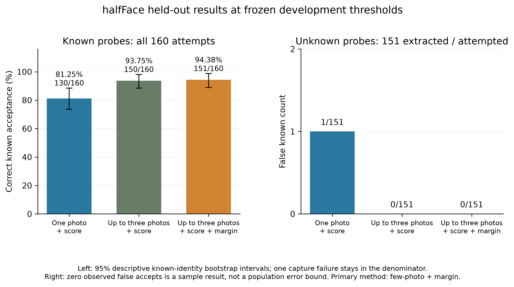

# Few-Photo Enrollment and Open-Set Face Recognition under Masking and Controlled Degradation: An Experimental Study

Integrated research draft, 23 October 2026 (Asia/Dhaka).

This working title describes the evaluated scope of DynaCampus-FR. The document
combines the frozen main evaluation, subsequent descriptive development studies,
the corrected ChokePoint supplement and the engineering demonstration. It is a
content draft for review; institutional front matter, author declarations and
submission formatting are not supplied by the available project materials.

## Abstract

Face-recognition prototypes must distinguish an enrolled person from an unknown
person while operating with limited enrollment photographs and degraded probes.
This study evaluates enrollment, aggregation and rejection choices around frozen
public recognition checkpoints. A predeclared final comparison on identity-disjoint
halfFace development and test partitions found that up-to-three-photo enrollment
with a calibrated score threshold correctly accepted 150/160 masked known probes,
compared with 130/160 for one-photo enrollment. Adding a top-two score-margin rule
accepted 151/160, with no observed false acceptance among 151 unknown probes.
Its incremental improvement over few-photo score-only decisions was one probe,
with a paired interval including zero. Subsequent development experiments with
ArcFace and AdaFace found no consistent benefit from a tested five-variant
synthetic enrollment profile. Fixed-probe gallery-growth experiments showed
composition-dependent unknown acceptance and ambiguity. In a separate corrected
ChokePoint study, five-frame averaging improved severe-tier Rank-1 from 295/303
to 302/303, but a calibration target did not reliably transfer across sequences:
mixed-track mean pooling falsely accepted 12/143 unknown queries. A persistent
gallery demonstration and CPU component measurements complement the experimental
results. The contribution is auditable evidence about existing components, not
a new recognition architecture or validation of campus CCTV deployment.

## 1. Introduction

The availability of a pretrained face recognizer does not determine how a new
person should be enrolled, how multiple observations should be combined, or when
the system should refuse to assign an identity. These choices matter when a
gallery contains only a few images per person and probes differ through masks,
pose, resolution loss, blur or compression. A high closed-set retrieval rate can
coexist with poor unknown rejection: finding the most similar enrolled template
does not establish that the query belongs to anyone enrolled.

DynaCampus-FR was motivated by low-quality campus surveillance and dynamic
enrollment. The implemented and evaluated study has a narrower scope: frozen
recognition checkpoints, still-image masked probes, controlled synthetic stress
tests, a separate crop-based temporal experiment and a working still-image gallery
prototype. No local campus dataset or trained domain adapter is claimed. Keeping
this scope explicit allows the results to address practical design choices
without implying deployment evidence that was not collected.

The research questions are:

1. How do one-photo and few-photo enrollment affect calibrated correct known
   acceptance and unknown acceptance on masked face probes?
2. Can mild synthetic variants of one enrollment photograph substitute for
   additional original views, and does the answer depend on the checkpoint/rule?
3. With probes and thresholds fixed, how do gallery size and composition affect
   recognition, unknown acceptance and ambiguity?
4. Under controlled degradation, does temporal quality weighting improve over
   uniform averaging, and do calibrated thresholds transfer across sequences?
5. What are the measured CPU costs of enrollment, image processing, gallery
   search and decision making within the tested software boundaries?

The contribution is a reproducible experimental investigation with retained
failure outcomes, frozen final-method selection, paired comparisons, full score
records and separate verification. The working gallery illustrates insertion,
persistence and removal without changing the recognizer checkpoint. Neither the
individual components nor their broad combination are claimed as unprecedented.

## 2. Related work and contribution boundary

ArcFace trains discriminative embeddings using an additive angular margin
[[1]](https://arxiv.org/abs/1801.07698v3).
Here an existing checkpoint supplies frozen features; its loss is not modified.
AdaFace makes its training margin depend on an image-quality proxy derived from
feature norms [[2]](https://arxiv.org/abs/2204.00964). Its public IR-50 checkpoint supplies a second development
baseline. Comparing the two downloaded checkpoints does not isolate their loss
functions because pretraining data and runtime implementations differ.

Quality pooling already appears in prior face-recognition work
[[3]](https://arxiv.org/abs/1804.01159). Consequently,
simple weighting, best-frame selection and averaging are treated as established
baselines to test, not inventions. The question is whether a particular quality
proxy and pooling policy improve recognition under the declared input conditions.
Evidence that a proxy correlates with similarity is distinct from evidence that
using it to weight frames improves identification.

The original ChokePoint work studies face selection and video-based recognition
in a surveillance setting [[5]](https://arma.sourceforge.net/chokepoint/). This thesis uses its supplied eye-aligned crops in
a custom sequence-separated experiment. It does not reproduce an official whole
benchmark score or evaluate detector/tracker performance. The halfFace dataset
provides a complementary masked/unmasked image setting
[[4]](https://data.mendeley.com/datasets/pk44mkx9vm/2); the public ICFD sample supplies
a separate classroom-image engineering check [[6]](https://sites.google.com/view/icfd).

The contribution relative to these sources is the specific auditable experiment:
original-versus-derived separation, paired enrollment choices, development-only
selection followed by a frozen identity-disjoint final comparison, counterexamples
to broad quality-weighting claims, fixed-probe gallery composition checks and
explicit separation of retrieval from unknown rejection. This targeted comparison
does not establish a first-in-literature claim or constitute a systematic review.

## 3. Data, integrity and evaluation roles

### 3.1 halfFace

The official halfFace version 2 release describes masked and unmasked photographs
of 166 South Asian participants and provides original and derived collections
[[4]](https://data.mendeley.com/datasets/pk44mkx9vm/2).
The present experiment uses original full-face images rather than treating
upper-face crops or supplied augmentations as independent observations.

The local integrity audit found 941 original full-face files. Six byte-identical
image pairs occurred under IDs p039 and p090; both IDs, comprising 12 files, were
excluded instead of inferring which label was correct. Three additional filenames
had ambiguous condition labels and were excluded from condition-based analysis.
The usable manifest therefore contains 926 images from 164 source identities.
Original media remain preserved. These checks exclude exact duplicates but do
not prove the absence of near duplicates or every possible label error.

Before the initial recognition experiment, identities were partitioned into
55 development-known, 27 development-unknown, 55 reserved-known and 27
reserved-unknown identities. Unknown identities were excluded from their
corresponding galleries. The reserved split was later consumed once for the
frozen final methods. Later experiments use development inputs; examined final
identities cannot become a fresh unseen test by another random partition.

Known probes use original masked photographs. Enrollment uses the available
original unmasked frontal image for one-photo enrollment and up to three
unmasked frontal/left/right images for few-photo enrollment. The number of
available original views varies. Enrollment and probe paths do not overlap.
The provenance and exclusion details are in [dataset preparation](DATASET_START.md).

### 3.2 ICFD public sample

ICFD was introduced for laboratory-to-classroom face recognition
[[6]](https://sites.google.com/view/icfd). Only its
public sample is available in this project; access to the full dataset is not
assumed. The local sample contains ten identities and 400 images, with gallery
and probe roles preserved. Five identities were used for development engineering
checks and five reserved identities for a separate closed-set check. These probes
contain no unknown identities, so open-set FPIR is not estimable from this sample.

### 3.3 Corrected ChokePoint supplement

The original Portal-1 entering crop archive and ground truth were downloaded
from the official distribution and checked against published archive checksums.
Crop identity labels were checked against frame-level annotations. The supplied
96x96 eye-aligned crops were used; a new detector or tracker was not run.

The custom protocol uses 17 gallery-known and eight unknown identities, with
one first-available enrollment crop per known identity from P1E_S1_C1. It makes
no claim that the chosen crop is frontal or quality-optimal. P1E_S2_C2 supplies
143 known and 66 unknown calibration tracks; P1E_S3_C3 and P1E_S4_C1 supply
303 known and 143 unknown evaluation tracks. Every query, known or unknown,
contains five consecutive non-overlapping frames from one identity/camera
sequence. Source files and exact image hashes are disjoint between these roles,
but identities recur. The supplied pilot already examined P1E, so the corrected
experiment remains exploratory rather than a newly unseen-data test.

## 4. Recognition and decision methods

### 4.1 Frozen still-image pipeline

The baseline uses a real SCRFD detector, five-point alignment to 112x112,
512-dimensional unit embeddings from a frozen ArcFace checkpoint and exact
cosine gallery search. A fixed neutral border of 50% of the source dimensions
is applied to the tightly cropped dataset inputs before detection, following
the existing development protocol. Model failures are explicit; synthetic
embeddings are confined to explicitly selected test fixtures.

AdaFace development comparisons use the same detector and aligned BGR crops,
with preprocessing checked against its pinned official implementation. Both
models retain the original checkpoints. The ArcFace bundle and AdaFace checkpoint
have different documented pretraining and use ONNX Runtime CPU and PyTorch CPU,
respectively. These differences limit causal interpretation of accuracy or speed
differences between the checkpoint implementations.

For source embeddings z_i, the gallery template is

`g = normalize(mean_i(z_i))`.

For a unit query z, gallery scores are `s_j = g_j dot z`. The top-two scores
are s1 and s2, with ambiguity margin `m = s1 - s2`. A single-gallery identity is
handled separately by the application. The evaluated research galleries contain
multiple identities, and their top-two scores are retained at full precision.

### 4.2 Four-state decisions and failures

The engine first rejects quality below a declared gate, then rejects scores
below the similarity threshold, then marks an insufficient top-two gap as
ambiguous. Otherwise it accepts the top identity. Its states are KNOWN, UNKNOWN,
AMBIGUOUS and INSUFFICIENT_QUALITY. Detection/alignment/extraction failures are
recorded as capture failures outside these four engine states.

The selected main quality gate is zero because the tested heuristic gate added
no development benefit. Quality never relaxes the application's match threshold.
The top-two margin is a gallery ambiguity measure, not the training margin used
by ArcFace or AdaFace. Correct acceptance requires both the correct identity and
an accepted decision; merely retrieving the right top match is insufficient.

### 4.3 Synthetic enrollment and temporal aggregation

The synthetic enrollment extension creates five mild variants of the same
aligned frontal enrollment crop: Gaussian blur sigma 1, cubic reduction to 56
pixels and restoration to 112, JPEG quality 50, and gamma 0.7 and 1.4. Its template
gives equal weight to the original and five variants. Probes are unchanged. This
tests one concrete recipe; synthetic variants add neither original viewpoints
nor independent people and do not reproduce masking.

The temporal supplement resizes ChokePoint crops to 112x112 before applying
clean/mild/medium/severe corruption or a seeded per-frame mixture. Severe
corruption combines blur, cubic downsampling to 28x28, independent Gaussian
noise with sigma 15 and JPEG quality 25. SHA-256-derived seeds bind each
corruption to a stable relative image path and condition.

The declared temporal policies are first frame, seeded random frame,
Laplacian/contrast-best frame, raw-feature-norm-best frame, uniform mean and
standardized norm-softmax weights at beta 0.5, 1, 2 and 5. Raw feature norms are
retained before unit normalization. Every method sees identical source tracks
and corrupted pixels. Paired contamination controls replace exactly one frame
per known track with the same foreign-identity image across all methods, under
matched-tier and mild-tier controls. They simulate an identity substitution;
they do not measure a tracker's error rate.

## 5. Experimental design, metrics and uncertainty

### 5.1 Frozen main evaluation

The primary final method and its settings were selected on development data
and frozen before reserved-image inference. The three final comparisons are
one-photo score decisions, few-photo score decisions and few-photo score/margin
decisions. They use separately development-calibrated score thresholds and
therefore compare complete calibrated methods. The margin ablation is not
presented as an isolated gate change at an otherwise identical threshold.

### 5.2 Additional development experiments

Augmented enrollment compares all three policies with both score-only and
score/margin families on the same 154 known and 150 unknown attempts. Two views
are retained: fixed previous one-photo thresholds, and separate development
recalibration. The latter optimizes known acceptance subject to at most 1%
conditional unknown FPIR and minimum 85% valid decision coverage for both truth
groups. The full candidate grid and deterministic tie-break are saved. Because
calibration and assessment reuse the same development probes, the result is
descriptive and optimistic, not another held-out test.

Gallery growth keeps a ten-identity core, 28 known attempts and the same 150
unknown attempts fixed. Additional identities are background gallery candidates,
not additional probes. One ten-person, five seeded 25-person and one full
55-person gallery use fixed original-photo templates and the previously selected
55-person thresholds. Only the 25-person background composition varies. Its
min/max ranges describe sensitivity to composition, not confidence intervals
from new independent participants.

### 5.3 Metrics and statistical interpretation

Rank-1 counts whether the correct known identity has the highest score, before
rejection. Correct known acceptance divides accepted-and-correct known queries
by all known attempts, including capture failures. Conditional FPIR divides
accepted unknown queries by successfully embedded unknown queries, including
those refused as ambiguous in the denominator. Attempted denominators and
extraction counts are also retained. Decision coverage measures how often the
system returns KNOWN or UNKNOWN instead of ambiguity, quality refusal or failure.

Pairwise verification FAR uses non-mated gallery/query comparisons; open-set
FPIR uses a single maximum-gallery decision per unknown query. They are not
interchangeable. Pairwise ROC, EER and TAR on the ChokePoint evaluation set are
descriptive curves, separate from the calibration-frozen identification results.
The temporal fixed and AOSM rules share a calibration target but may obtain
different actual evaluation FPIR. AOSM includes its declared threshold floor.

Paired intervals resample known identities while preserving the paired outcomes:
2,000 resamples for the new enrollment development comparison and 1,000 for
ChokePoint. They condition on selected thresholds and available identities and
do not include uncertainty from calibrating on another sample or collecting new
cameras/sites. Small or zero-width empirical intervals at ceiling do not prove
population equivalence. Multiple ablations are descriptive; no broad claim is
made from unadjusted significance tests. Observing zero false accepts in a small
sample does not establish a zero population error probability.

## 6. Results

### 6.1 Primary identity-disjoint halfFace comparison

| Calibrated method | Correct top match / 160 | Correct known acceptance / 160 | False unknown acceptance / 151 |
|---|---|---|---|
| One original + score | 159 | 130 (81.25%) | 1 |
| Up to three originals + score | 159 | 150 (93.75%) | 0 |
| Up to three originals + score/margin, primary | 159 | 151 (94.38%) | 0 |

All methods use the same 55 reserved-known and 27 reserved-unknown identities.
One known extraction failure remains included. No wrong enrolled identity is
accepted by any of these methods. The primary correct-known-acceptance interval
is 88.89%-98.74% under the known-identity bootstrap. Its decision counts are 151
KNOWN, 158 UNKNOWN, one AMBIGUOUS and one capture failure. End-to-end decision
coverage is 309/311 (99.36%).

Few-photo score decisions improve acceptance over one-photo score decisions
by 12.50 percentage points, with paired interval +6.92 to +18.75 points. Adding
the margin rule to few-photo enrollment helps two known probes and harms one,
for a net +0.62 points, with interval -1.28 to +2.55. Thus enrollment accounts
for the larger observed gain; superiority of the additional margin rule is not
established by this sample. [Frozen results and numeric sources](../paper_assets/heldout/final_v1/README.md).

The separate reserved ICFD public sample gives 98/100 closed-set retrieval for
both enrollment policies. Two extraction failures remain included. Without
unknown identities, this engineering check does not support an FPIR estimate
or a claim about the full ICFD release.

### 6.2 Backbone, pooling and stress-test development evidence

The paired ArcFace/AdaFace study used identical source crops, with all 564
successful ArcFace features reproducing their cache and seven shared capture
failures. Separately calibrated score-only few-photo enrollment improved known
acceptance for both checkpoints. With score/margin calibration, ArcFace one-photo
and few-photo policies tied at 139/154, while AdaFace increased from 120 to
133/154. This interaction limits a universal enrollment-benefit claim.
[Backbone experiment](../paper_assets/development/backbones_v1/README.md).

An earlier original-photo pooling comparison found no consistent advantage of
heuristic quality or detector-confidence weighting over the uniform mean.
Detector weighting's one-probe recalibrated gain reversed under the fixed prior
margin rule. [Pooling experiment](../paper_assets/development/pooling_v1/README.md).
Controlled blur, resolution and JPEG tests also retained transformed-image
extraction failures and unknown decisions. These reuse development source images
and do not create new original participants or establish real CCTV accuracy.
[Stress tests](../paper_assets/development/robustness_v1/README.md).

### 6.3 Synthetic one-photo enrollment

| Checkpoint | Rule | One original | Original + five variants | Up to three originals |
|---|---|---|---|---|
| ArcFace | separately calibrated score | 129/154, FA 1/149 | 128/154, FA 1/149 | 138/154, FA 1/149 |
| ArcFace | separately calibrated score/margin | 139/154, FA 1/149 | 135/154, FA 0/149 | 139/154, FA 1/149 |
| AdaFace | separately calibrated score | 112/154, FA 1/149 | 111/154, FA 0/149 | 122/154, FA 1/149 |
| AdaFace | separately calibrated score/margin | 120/154, FA 1/149 | 123/154, FA 1/149 | 133/154, FA 0/149 |

FA denotes unknown queries falsely accepted. The tested five-variant recipe
does not improve score-only acceptance on either checkpoint. AdaFace's margin
gain is three probes (+1.95 points), with a paired interval touching zero;
ArcFace's corresponding known acceptance falls by four probes while unknown
false acceptance falls from one to zero. These are operating-point trade-offs,
not a general ranking of augmentation methods.

The fixed-one-photo-threshold view is retained separately. For example, ArcFace
with three originals accepts 143 known probes but also four unknowns, compared
with 139 known and one unknown for one original. Reporting only the acceptance
gain would obscure the changed rejection behavior.
[Full paired effects, both threshold views and raw predictions](../paper_assets/development/extensions_v1/README.md).

### 6.4 Fixed-probe gallery growth

Both checkpoints retain 26/28 known Rank-1 matches in the fixed core across all
seven gallery compositions. ArcFace correct acceptance is 23/28 for both rules
at every size. AdaFace's margin rule changes from 24/28 at ten identities to
23/28 at 25 and 55 identities. The two known failures remain in the denominator.

Unknown behavior depends on composition and rule. ArcFace's score-only rule
changes from zero false accepts at ten identities to one at 55, with zero or
one across 25-person compositions. Its margin rule also varies between zero
and one. AdaFace's score-only rule accepts one unknown at every size; its margin
rule accepts two at ten identities, zero to two at 25 and zero at 55.

An unknown query's maximum cosine score cannot decrease when a nested exact
gallery grows. A score/margin acceptance decision is different: adding a close
competitor can create ambiguity and refuse a previously accepted query. This
explains why margin-based false acceptance need not grow monotonically. The
small core and overlapping background selections do not establish recognition
accuracy at large gallery sizes.

### 6.5 Corrected temporal supplement

Under severe synthetic degradation, first-frame Rank-1 is 295/303 (97.36%),
versus 302/303 (99.67%) for uniform five-frame mean pooling. The paired difference
is +2.31 points, with a 95% identity-cluster interval of +0.96 to +3.75 points.
Pairwise TAR at FAR <=1% changes from 89.11% to 95.38%, while EER changes from
4.93% to 2.37%. These pairwise metrics do not measure unknown-query FPIR.

On mixed-quality tracks, mean pooling and norm-softmax beta 1 both obtain
303/303 Rank-1; weighting adds no Rank-1 benefit there. The same mildly degraded
intruder substituted into one of five known-track frames leaves uniform mean
at 303/303, but norm-best selection drops to 171/303 and norm-softmax beta 1
to 205/303. Matched-tier intrusion also harms quality selection. This is paired
simulated contamination, not measured SORT or ByteTrack behavior.

The quality diagnostic finds that mean Laplacian/contrast quality rises from
0.1901 at medium to 0.3416 at severe corruption, consistent with noise inflating
a sharpness proxy. Raw feature norm drops from 21.58 to 19.51. Nevertheless,
within-tier Laplacian/similarity correlation is positive in this corrected run;
non-monotonic tier means do not imply that the proxy is universally useless.
Norm correlations are moderate, approximately 0.33-0.36 across tiers.

The open-set limitation is substantial: fixed mean pooling accepts all 303
mixed-track known queries but also 12/143 unknown queries (8.39% FPIR), despite
zero false accepts among 66 calibration unknown tracks. Floored AOSM accepts
the same known queries and 13/143 unknowns. On severe tracks, fixed and AOSM
both accept 282/303 known queries but accept four and three unknowns, respectively.
Their empirical evaluation FPIR differs, so these are not exactly matched-FPIR
comparisons. The threshold target did not reliably transfer across recording
sequences, and evaluation thresholds were not retuned after observing this result.
[Corrected protocol, limits, figures and scores](../paper_assets/supplementary/chokepoint_v1/README.md).

### 6.6 CPU runtime and dynamic gallery demonstration

| Measured boundary | ArcFace median / p95 ms | AdaFace median / p95 ms |
|---|---|---|
| Decode through persistent one-photo insertion | 136.97 / 173.15 | 199.88 / 221.32 |
| Decode through search and decision | 143.81 / 175.57 | 207.03 / 241.83 |
| Recognition detection stage | 86.39 / 92.58 | 88.21 / 97.99 |
| Recognition embedding stage | 44.19 / 55.06 | 103.71 / 113.00 |
| Actual search-call microbenchmark at 55 identities | 0.0637 / 0.0708 | 0.0635 / 0.0695 |

These measurements use Windows 11, an AMD64 Family 23 Model 113 Stepping 0
processor with 12 logical CPUs, two inference threads per engine, ONNX Runtime
CPU for ArcFace and PyTorch CPU for AdaFace. Actual threadpool details are saved.
There are 30 enrollment and 60 recognition image calls per checkpoint, and 300
search/decision calls at each of three gallery sizes. Repetitions measure warm
latency, not additional accuracy samples. Enrollment directly times decoding
through a fresh insertion into an isolated 55-entry gallery; restoration is
excluded. Recognition directly times decoding through the four-state decision.
Full-path values are measured wall times rather than sums of stage medians.

Search includes validation, matrix reconstruction, cosine scoring, sorting and
metadata lookup. Detection and embedding dominate these measured paths.
Model startup/warmup, browser/UI transfer, camera capture and network transport
are excluded. The table does not imply camera FPS or isolate the training losses
of two checkpoints with different engines and pretraining.

The existing still-image demonstration validates real original-photo enrollment,
known/unknown decisions, persistence, reload and removal using development
examples. It demonstrates that insertion does not update recognizer weights.
Actual earlier browser screenshots and later AppTest checks have different
evidence scopes and are labelled accordingly. A dashboard control's presence
does not establish live camera, RTSP or temporal pipeline performance.
[Application evidence](../paper_assets/development/demo_v1/README.md) and
[defense cases](DEFENSE_CASE_ANALYSIS.md).

## 7. Discussion, limitations and practical interpretation

Additional original views provide the strongest main held-out enrollment gain
under this masked-probe protocol. The synthetic profile does not consistently
replace them, and checkpoint/rule interactions qualify any broad claim about
adding photos. A useful evaluation must show unknown acceptance and coverage
alongside correct known acceptance; a policy can accept more known queries
simply by operating at a more permissive point.

Uniform temporal averaging is a useful baseline in the corrected synthetic
experiment. Quality correlation alone does not establish a pooling advantage,
and selecting a high-norm intruder illustrates a failure mode of quality-based
selection. Independent synthetic noise can favor averaging; real degradation
can be correlated across frames. Neither the size of this simulation's effect
nor its ranking establishes behavior of a particular tracker or camera system.

The ChokePoint transfer failure also shows why a development FPIR target is not
a deployment guarantee. The unknown calibration sample is small, identities recur
and camera changes are confounded with recording sequence. A future operational
study requires representative calibration, separate evaluation and sufficient
unknown observations. The present failure is reported rather than hidden by
retuning on examined evaluation outcomes.

Other limits include the public datasets' capture conditions, possible near
duplicates not detected by exact hashing, differing pretraining distributions,
small unknown identity counts, conditional uncertainty estimates and repeated
development use. The ICFD sample does not represent its full release. There is
no local campus collection, validated domain adaptation, trained quality model,
complete video/tracker benchmark or evidence of Bangladesh-wide performance.
No unmeasured detector accuracy, fairness, speed or deployment benefit is claimed.

## 8. Reproducibility, data handling and evidence audit

Source manifests retain original/derived roles, anonymous dataset IDs, exclusions,
hashes and frozen splits. Model assets have hashes and provenance. Raw identifiable
images, derived inspection grids and biometric arrays stay in ignored local data
directories; public figures contain no participant portraits. The existing source
access terms and required dataset attributions are retained. No new campus
participant consent or institutional recording approval is implied by using
public research inputs.

The existing final audit recomputes 1,133 attempts and 1,126 successful searches
while verifying all 585 original input hashes and frozen settings. The corrected
ChokePoint verifier checks 41,265 predictions, 701,505 gallery scores and 13,168
corrupted pixel arrays. The new enrollment/growth verifier replays all 550 variant
model forwards and checks 12,280 predictions, 28,608 calibration candidates,
1,800 runtime searches and 5,220 timing samples. These are separate recomputation
scripts, not external peer review or third-party replication. All 104 software
tests pass; tests establish implementation behavior rather than population accuracy.

The [evidence index](../paper_assets/README.md) links results, captions, scores,
verification receipts and reproduction commands. Previously consumed final data
remain reserved for reporting their frozen methods. Subsequent experiments are
explicitly labelled development or exploratory supplementary work.

## 9. Conclusion

This study supports a measured experimental contribution around frozen face
recognizers. Few original enrollment views improved the primary held-out masked
recognition comparison; the additional margin effect was small and uncertain.
The tested mild synthetic enrollment profile offered no consistent improvement.
Fixed-probe growth exposed gallery-composition and ambiguity effects, while
runtime measurements separated image processing from inexpensive small-gallery
search. Temporal mean pooling improved severe synthetic retrieval but did not
solve unknown rejection or calibration transfer. These findings favor explicit
baselines, paired inputs and complete outcome reporting over claims based only
on high retrieval accuracy or a working interface.

## References

1. J. Deng, J. Guo, N. Xue and S. Zafeiriou. ArcFace: Additive Angular Margin
   Loss for Deep Face Recognition. CVPR, 2019. [Author preprint, 2019 version](https://arxiv.org/abs/1801.07698v3).
2. M. Kim, A. K. Jain and X. Liu. AdaFace: Quality Adaptive Margin for Face
   Recognition. CVPR, 2022. [Author paper](https://arxiv.org/abs/2204.00964).
3. R. Ranjan et al. Crystal Loss and Quality Pooling for Unconstrained Face
   Verification and Recognition. [Author preprint](https://arxiv.org/abs/1804.01159).
4. T. Ghosh et al. halfFace: A face covering mask dataset of South Asian people,
   version 2, 2022. DOI: 10.17632/pk44mkx9vm.2.
   [Original dataset record](https://data.mendeley.com/datasets/pk44mkx9vm/2).
5. Y. Wong, S. Chen, S. Mau, C. Sanderson and B. C. Lovell. Patch-based
   Probabilistic Image Quality Assessment for Face Selection and Improved
   Video-based Face Recognition. CVPR Workshops, 2011. The official dataset
   reference lists pages 81-88. [Dataset and reference](https://arma.sourceforge.net/chokepoint/).
6. A. Bhattacharjee and S. Das. D2SC-GAN: Dual Deep-Shallow Channeled Generative
   Adversarial Network, for Resolving Low-Resolution Faces for Recognition in
   Classroom Scenarios. IEEE TBIOM 2(3), 223-234, 2020.
   DOI: 10.1109/TBIOM.2020.2983524. [Official ICFD source and citation](https://sites.google.com/view/icfd).

## Appendix: review and submission work remaining

The quantitative experiments and this integrated content draft are available for
review. Institutional formatting, supervisor feedback, final citation-style checks,
defense slides and a fresh live defense recording remain submission tasks. These
items are separate from the completed experiments and are not marked submitted
or institutionally approved by this draft.
