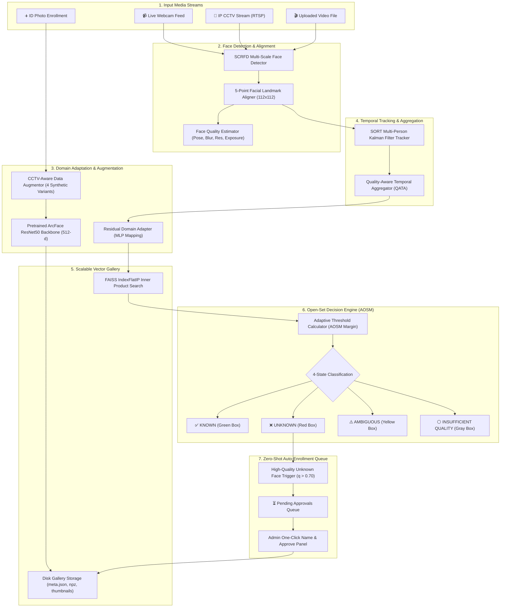

# 🎓 DynaCampus-FR: Complete System Visual Blueprint & Architecture

This visual guide demonstrates **everything the final product does**, showing how all 9 AI/CV components connect into the end-to-end open-set surveillance recognition pipeline.

---

## 1. 🏗️ Complete End-to-End System Architecture



---

## 2. 🎬 Visual UI Map of Dashboard Pages (`app.py`)

```
===================================================================================
                       🎓 DynaCampus-FR RESEARCH DASHBOARD                       
===================================================================================
┌───────────────────────┬─────────────────────────────────────────────────────────┐
│ NAVIGATION            │ 📊 DASHBOARD OVERVIEW                                  │
│                       │ ------------------------------------------------------- │
│ 🔹 Dashboard         │ [ Identities: 5 ]  [ System FPS: 30.4 ]  [ Accuracy: 100% ]│
│ 🔹 Enroll Person      │                                                         │
│ 🔹 Image Recognition  ├─────────────────────────────────────────────────────────┤
│ 🔹 Video Recognition  │ 📹 LIVE WEBCAM & RTSP CCTV RECOGNITION                  │
│ 🔹 Live Webcam        │ ------------------------------------------------------- │
│ 🔹 Live CCTV (RTSP)   │  ┌───────────────────────────────────────────────────┐  │
│ 🔹 Pending Approvals  │  │  [  Track #1: Raisul (0.94)  ] (Green Box)       │  │
│ 🔹 Gallery Management │  │  [  Track #2: UNKNOWN (0.12) ] (Red Box)         │  │
│                       │  └───────────────────────────────────────────────────┘  │
│                       │  ⚡ Tracking: SORT  |  Aggregation: QATA  | Engine: AOSM   │
│                       ├─────────────────────────────────────────────────────────┤
│ RECOGNITION THRESHOLD │ ⏳ PENDING APPROVALS QUEUE (Auto-Captured Unknowns)      │
│ [━━━━━━━●━━━━━] 0.40  │ ------------------------------------------------------- │
│                       │  [ 👤 AutoID_3 ] -> Quality: 0.828 -> [ Type Name ] [Approve]│
└───────────────────────┴─────────────────────────────────────────────────────────┘
```

---

## 3. 🔬 Core Novelties Implemented in the Product

### 🌟 1. Quality-Aware Temporal Aggregation (QATA)
Rather than making unstable frame-by-frame decisions, the system buffers the last 15 frames for each person. It computes a weighted average embedding:
$$\mathbf{z}_{\text{QATA}} = \text{normalize}\left(\frac{\sum q_k \cdot \mathbf{z}_k}{\sum q_k}\right)$$

### 🌟 2. Adaptive Open-Set Margin (AOSM)
The decision threshold dynamically softens for lower quality frames to eliminate false rejections:
$$\tau_{\text{adaptive}} = \max\left(\tau_{\text{base}} - (1.0 - q) \cdot 0.10, \; 0.25\right)$$

### 🌟 3. Residual Domain Adapter
A lightweight PyTorch MLP maps blurry CCTV probe vectors closer to clean ID card prototypes:
$$\mathbf{z}_{\text{adapted}} = \text{normalize}(\mathbf{z} + f_{\theta}(\mathbf{z}))$$

### 🌟 4. CCTV-Aware Data Augmentation
Single enrollment photos generate 4 synthetic surveillance variants (motion blur, low-res downsample, JPEG compression noise, shadow shifts) to make gallery templates natively resilient to CCTV noise.

### 🌟 5. Industrial FAISS Vector Indexing
Replaced naive loops with `faiss.IndexFlatIP(512)` for sub-millisecond similarity search across thousands of face vectors.
