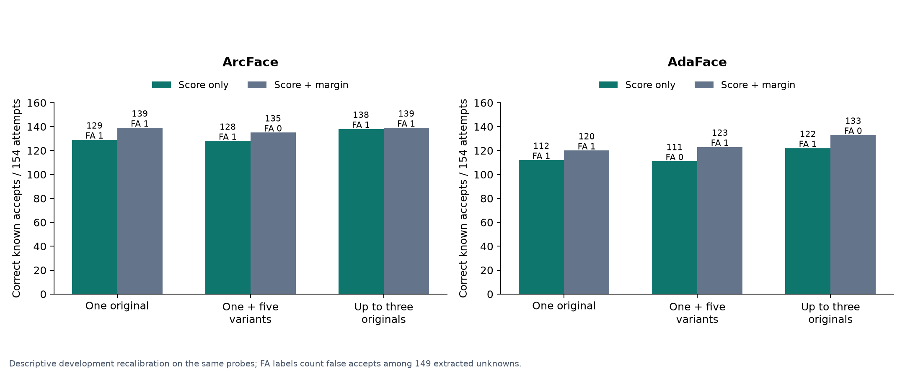
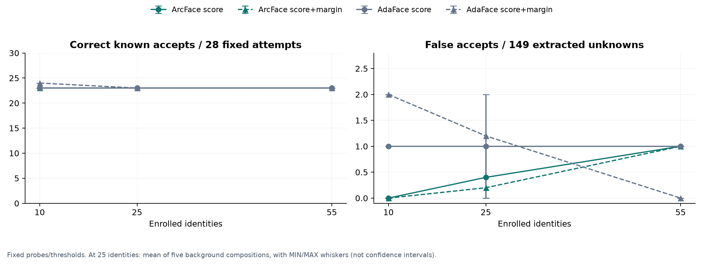
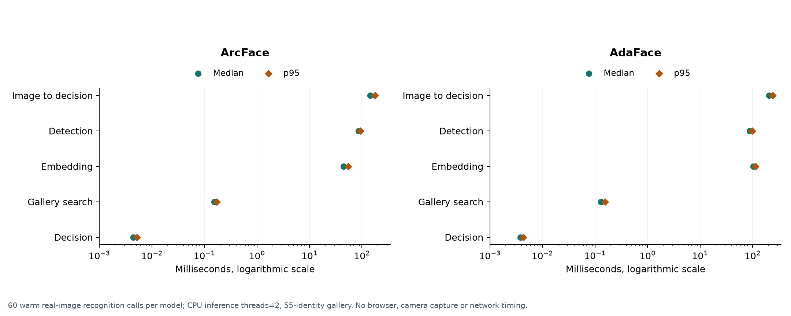
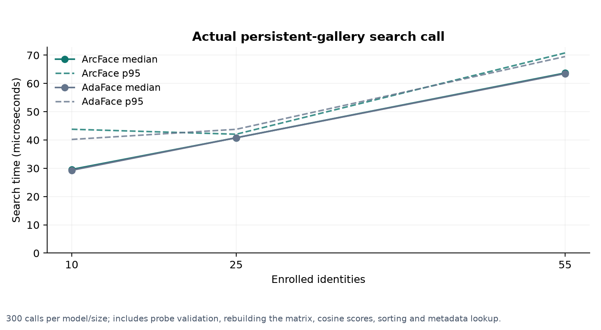

# Augmented enrollment, gallery growth and runtime

Completed 23 October 2026 (Asia/Dhaka). **Verified descriptive development
evidence**, separate from the frozen halfFace final evaluation. No training,
reserved-test image inference or application-default change was performed.

Run: `results/enrollment_extensions/extensions_20261022T193101706934Z`. [Separate verification](../../../results/enrollment_extensions/extensions_20261022T193101706934Z/verification.json) replayed all
550 synthetic-variant model forwards and checked 12,280
predictions, 28,608 calibration candidates,
1,800 runtime searches and 180 real-image timing calls. The full suite passes
104 tests. [Integrated thesis draft](../../../docs/THESIS_DRAFT.md).

## Augmented one-photo enrollment

Same 55 development gallery identities, 154 masked known attempts and 150
unknown attempts; 148 known and 149 unknown probes yield embeddings. All seven
capture failures remain in attempted denominators. Existing original-photo
features are reused for both public checkpoints. Fresh detection/alignment of
each frontal enrollment source reproduces its original crop and feature cache.

Three policies: one original frontal photo; that same aligned crop plus five
equally weighted variants (Gaussian blur sigma 1, cubic down/up to 56 pixels,
JPEG quality 50, and gamma 0.7/1.4); and up to three original unmasked views.
Templates are normalized means. The variants do not add independent people,
views or test samples, and do not simulate masking. Probes are unchanged.
Augmented crops are not redetected. The original has weight 1/6 in its six-vector
template; this is one declared recipe, not an exhaustive augmentation search.

### Separately calibrated development comparison

| Checkpoint | Rule | Enrollment | Correct known / attempts | False unknown acceptance | Valid decision coverage |
|---|---|---|---|---|---|
| arcface | score_only | One original | 129/154 | 1/149 | 100.00% |
| arcface | score_only | One + five variants | 128/154 | 1/149 | 100.00% |
| arcface | score_only | Up to three originals | 138/154 | 1/149 | 100.00% |
| arcface | score_margin | One original | 139/154 | 1/149 | 98.99% |
| arcface | score_margin | One + five variants | 135/154 | 0/149 | 97.64% |
| arcface | score_margin | Up to three originals | 139/154 | 1/149 | 99.33% |
| adaface | score_only | One original | 112/154 | 1/149 | 100.00% |
| adaface | score_only | One + five variants | 111/154 | 0/149 | 100.00% |
| adaface | score_only | Up to three originals | 122/154 | 1/149 | 100.00% |
| adaface | score_margin | One original | 120/154 | 1/149 | 95.96% |
| adaface | score_margin | One + five variants | 123/154 | 1/149 | 95.29% |
| adaface | score_margin | Up to three originals | 133/154 | 0/149 | 93.27% |

Calibration and evaluation reuse these same development probes. Score/margin
selection maximizes correct known acceptance subject to <=1% conditional FPIR
and at least 85% valid known/unknown decision coverage. The full candidate grid
and deterministic tie-break are saved. These are optimistic descriptive results,
not a held-out estimate or evidence of 1% population FPIR.



The tested synthetic enrollment profile does not improve score-only acceptance
on either checkpoint: ArcFace changes 129 to 128 and AdaFace 112 to 111 out of
154 attempts. Margin decisions interact with the checkpoint: ArcFace changes
139 to 135 while AdaFace changes 120 to 123 after separate calibration.
The latter small gain has a paired interval touching zero. Three originals
increase score-only acceptance to 138 for ArcFace and 122 for AdaFace. These
findings support reporting the exact policy/checkpoint/rule, not a universal
claim that augmentation helps or never helps.

| Checkpoint | Paired comparison | Rule | Change (points) | Descriptive 95% interval (points) |
|---|---|---|---|---|
| arcface | One + five variants minus one original | score_only | -0.65 | [-2.01, +0.00] |
| arcface | Up to three originals minus one original | score_only | +5.84 | [+1.31, +11.61] |
| arcface | One + five variants minus one original | score_margin | -2.60 | [-5.19, -0.63] |
| arcface | Up to three originals minus one original | score_margin | +0.00 | [-2.53, +2.61] |
| adaface | One + five variants minus one original | score_only | -0.65 | [-2.04, +0.00] |
| adaface | Up to three originals minus one original | score_only | +6.49 | [+1.28, +12.18] |
| adaface | One + five variants minus one original | score_margin | +1.95 | [+0.00, +4.40] |
| adaface | Up to three originals minus one original | score_margin | +8.44 | [+1.37, +15.79] |

Intervals resample 55 known identities 2,000 times with fixed selected thresholds;
they omit calibration and unknown-sample uncertainty. Multiple ablations are
descriptive, without an unadjusted significance claim.

### Fixed previous one-photo score/margin rule

| Checkpoint | Enrollment | Correct known / attempts | False unknown acceptance |
|---|---|---|---|
| arcface | One original | 139/154 | 1/149 |
| arcface | One + five variants | 139/154 | 2/149 |
| arcface | Up to three originals | 143/154 | 4/149 |
| adaface | One original | 120/154 | 1/149 |
| adaface | One + five variants | 123/154 | 1/149 |
| adaface | Up to three originals | 139/154 | 5/149 |

This view holds each checkpoint's previous one-photo rule fixed across policies.
It is not an equal-FPIR comparison. For example, ArcFace's three-original
acceptance of 143 accompanies four false accepts, versus 139 and one for one
original. Those rates must be interpreted together. Both threshold views are
retained rather than selecting whichever favors a policy.

## Fixed-probe gallery growth

The first ten IDs in the original frozen development-known order form the core.
They contribute 28 masked known attempts (26 extracted). The same 150 unknown
attempts (149 extracted) are used at every size. The other 45 known development
identities are background gallery entries and never enter these probes. Unknown
identities are never enrolled. All templates use up to three original photos.

The ten-core and full 55-person galleries are each evaluated once. Five seeded
25-person galleries add 15 different background selections to the same core.
Each checkpoint's existing 55-person score and score/margin thresholds stay
fixed for all seven compositions. Thus neither probes nor thresholds change
when the gallery grows.

| Checkpoint | Rule | Gallery identities | Correct known / 28 | False unknown acceptance / 149 |
|---|---|---|---|---|
| arcface | score_only | 10 | 23/28 | 0/149 |
| arcface | score_only | 25 | 23/28 | 0-1/149 |
| arcface | score_only | 55 | 23/28 | 1/149 |
| arcface | score_margin | 10 | 23/28 | 0/149 |
| arcface | score_margin | 25 | 23/28 | 0-1/149 |
| arcface | score_margin | 55 | 23/28 | 1/149 |
| adaface | score_only | 10 | 23/28 | 1/149 |
| adaface | score_only | 25 | 23/28 | 1/149 |
| adaface | score_only | 55 | 23/28 | 1/149 |
| adaface | score_margin | 10 | 24/28 | 2/149 |
| adaface | score_margin | 25 | 23/28 | 0-2/149 |
| adaface | score_margin | 55 | 23/28 | 0/149 |

Ranges at 25 identities describe composition sensitivity, not confidence
intervals or independent new participants. Rank-1 is unchanged at 26/28 for both
checkpoints across these compositions. This small core does not establish
accuracy at arbitrary scale. Score-only unknown maximum similarity is
nondecreasing in nested galleries, but score/margin false accepts need not be:
added competitors can also trigger ambiguity. AdaFace illustrates this with
two false accepts at ten identities and zero at 55 under its fixed margin rule.



## Actual CPU runtime

Environment: Windows 11, AMD64 Family 23 Model 113 Stepping 0 processor,
12 logical CPUs, two inference threads per engine, ONNX Runtime CPU for ArcFace
and PyTorch CPU for AdaFace. NumPy BLAS pool is two threads; complete loaded-pool
details, including other libraries, are saved in the environment receipt.
Both pretrained checkpoints and all source images are hashed.

| Checkpoint | Timed boundary | Calls | Median ms | p95 ms |
|---|---|---|---|---|
| arcface | enrollment: enrollment_end_to_end | 30 | 136.9683 | 173.1506 |
| arcface | enrollment: persistent_insertion | 30 | 1.8721 | 2.7116 |
| arcface | recognition: recognition_end_to_end | 60 | 143.8087 | 175.5687 |
| arcface | recognition: detection | 60 | 86.3946 | 92.5805 |
| arcface | recognition: embedding | 60 | 44.1930 | 55.0558 |
| arcface | recognition: gallery_search | 60 | 0.1542 | 0.1711 |
| arcface | recognition: decision | 60 | 0.0044 | 0.0052 |
| adaface | enrollment: enrollment_end_to_end | 30 | 199.8750 | 221.3193 |
| adaface | enrollment: persistent_insertion | 30 | 1.5802 | 2.1713 |
| adaface | recognition: recognition_end_to_end | 60 | 207.0253 | 241.8298 |
| adaface | recognition: detection | 60 | 88.2088 | 97.9901 |
| adaface | recognition: embedding | 60 | 103.7119 | 113.0020 |
| adaface | recognition: gallery_search | 60 | 0.1299 | 0.1541 |
| adaface | recognition: decision | 60 | 0.0038 | 0.0043 |

Enrollment measures direct wall time from image-file decoding through a fresh
persistent identity insertion into a 55-entry isolated gallery (55 to 56 entries),
then restores the benchmark gallery outside the timed window. Ten fixed original
enrollment inputs are repeated three times per checkpoint. Recognition uses ten
known and ten unknown original probes, repeated three times, from decoding
through actual gallery search and four-state decision. All 180 sampled calls
produce valid features; the sampler is not a new accuracy study.



An additional 300 real search/decision calls per model at each gallery size
measure the actual FaceGallery implementation: validation, matrix reconstruction,
cosine scores, sorting and metadata lookup. ArcFace search medians are about
0.030, 0.041 and 0.064 ms at 10, 25 and 55 identities. Full ArcFace image-to-decision
median is about 143.81 ms, substantially larger than search alone.



Repeated calls on fixed inputs measure warm laptop latency, not independent
accuracy samples. Model load/warmup, browser/UI transfer, camera capture and
network/RTSP are excluded. End-to-end values are directly measured wall times;
they are not sums of component medians and are not camera FPS. Checkpoint
pretraining, architecture details and runtime engines differ, so the ArcFace/
AdaFace timing gap does not isolate either training loss.

## Reproduce and inspect

```powershell
.\.venv\Scripts\python.exe -u scripts/run_enrollment_extensions.py --prepare
.\.venv\Scripts\python.exe -u scripts/run_enrollment_extensions.py --run <new-prepared-run>
.\.venv\Scripts\python.exe scripts/verify_enrollment_extensions.py results/enrollment_extensions/extensions_20261022T193101706934Z
.\.venv\Scripts\python.exe scripts/render_enrollment_extensions.py results/enrollment_extensions/extensions_20261022T193101706934Z
```

Sources: [augmentation summary](../../../results/enrollment_extensions/extensions_20261022T193101706934Z/augmentation_summary.csv),
[all augmentation predictions](../../../results/enrollment_extensions/extensions_20261022T193101706934Z/augmentation_predictions.csv),
[thresholds](../../../results/enrollment_extensions/extensions_20261022T193101706934Z/augmentation_thresholds.csv), [candidate grid](../../../results/enrollment_extensions/extensions_20261022T193101706934Z/augmentation_grid.csv),
[paired effects](../../../results/enrollment_extensions/extensions_20261022T193101706934Z/paired_effects.csv), [growth summary](../../../results/enrollment_extensions/extensions_20261022T193101706934Z/growth_summary.csv),
[growth predictions](../../../results/enrollment_extensions/extensions_20261022T193101706934Z/growth_predictions.csv), [selection manifest](../../../results/enrollment_extensions/extensions_20261022T193101706934Z/selection.json),
[runtime samples](../../../results/enrollment_extensions/extensions_20261022T193101706934Z/runtime_samples.csv), [runtime summary](../../../results/enrollment_extensions/extensions_20261022T193101706934Z/runtime_summary.csv),
[timing boundaries and hardware](../../../results/enrollment_extensions/extensions_20261022T193101706934Z/runtime_environment.json).
Face images, derived inspection grids and embedding arrays remain under ignored
data/. These public figures contain no participant portraits.
