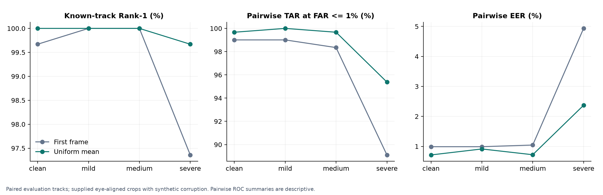
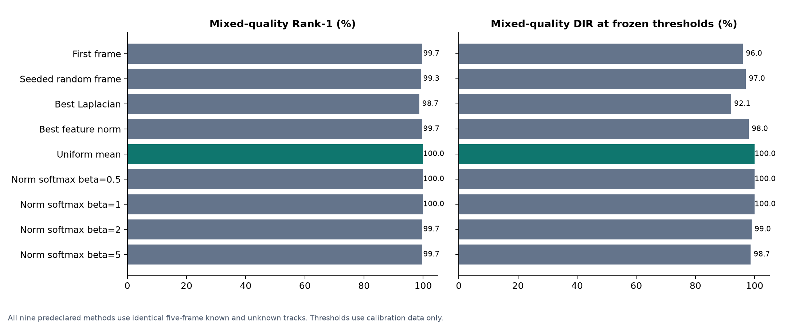
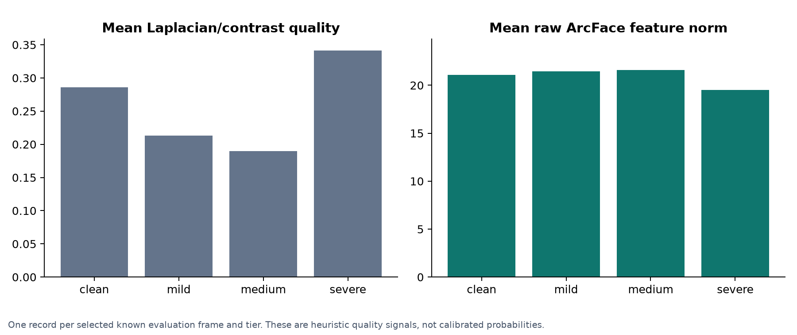
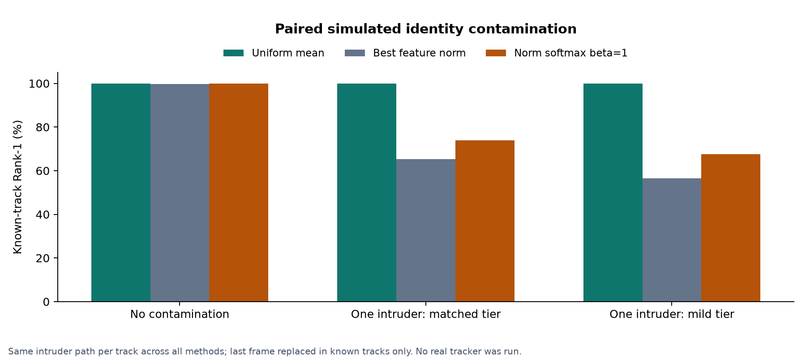
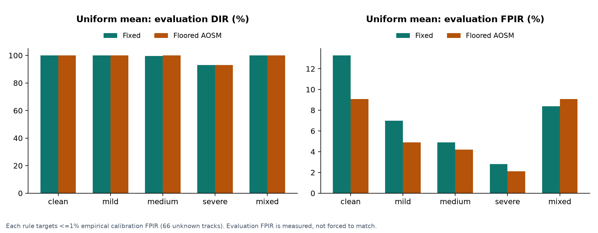

# Corrected ChokePoint temporal study

Completed 23 October 2026 (Asia/Dhaka). **Verified exploratory supplementary
evidence.** This is a corrected sequence-separated experiment, not a reproduction
of the supplied paper's numbers or a fresh unseen-identity test. It supplements
the existing still-image research; it does not establish campus CCTV performance.

Run: `results/chokepoint/temporal_20261022T185858644292Z`. [Independent verification](../../../results/chokepoint/temporal_20261022T185858644292Z/verification.json).
The verifier checked 41,265 query predictions,
701,505 gallery scores, 13,168
corrupted pixel arrays and 8 repeated real-model samples.

## Protocol and research question

Does temporal averaging help frozen recognition under synthetic degradation,
does quality weighting improve on that baseline, and how do quality thresholds
and simulated identity contamination affect recognition?

- Original ChokePoint P1E crop and ground-truth archives, verified against
  official published MD5s; source/terms receipts stay under ignored data/.
- 25 identities split deterministically into 17 gallery-known and 8 unknown.
  One first-available numeric crop per known identity from P1E_S1_C1; no claim
  that this crop was selected as frontal or optimal quality.
- Calibration: P1E_S2_C2, 143 known and
  66 unknown tracks. Evaluation: P1E_S3_C3 and
  P1E_S4_C1, 303 known and 143 unknown tracks.
  Roles have disjoint files/sequences; their identity populations are shared.
- Five numerically consecutive frames per track, no overlap or crossing camera,
  sequence or identity boundaries. Earliest eligible tracks up to 15 per identity
  per sequence; unused-frame accounting is saved, not hidden.
- Supplied eye-aligned 96x96 grayscale crops decoded as BGR, resized to 112x112
  using cubic interpolation BEFORE corruption. Four fixed tiers and seeded mixed
  tracks; severe cubic downsampling to 28x28 and independent noise sigma 15.
  No detector, landmark estimator or real tracker is evaluated.
- Real frozen ArcFace ResNet-50, CPU ONNX inference; raw feature norms retained
  separately from unit embeddings. Gallery templates and checkpoint stay fixed.
- Nine predeclared aggregation policies use exactly the same pixels. Unknown
  queries are also five-frame tracks. Beta settings are diagnostic comparisons,
  not selected using evaluation outcomes.
- Each method/condition's fixed and floored-AOSM thresholds are frozen from
  unknown calibration scores at <=1% empirical FPIR. With 66 unknown calibration
  tracks, this requires zero observed false accepts. This does not guarantee
  1% population FPIR. AOSM uses margin 0.08, floor 0.20 and norm bounds 16-22.
- Paired 95% percentile intervals use 1,000 identity-cluster resamples, retaining
  both evaluation sequences and adjacent tracks within the sampled identity.
  These do not measure uncertainty over independently sampled cameras/sites.

## First frame versus temporal mean

The useful findings are separate: temporal mean pooling improves severe-tier
retrieval, while calibration does not reliably transfer at the intended false
acceptance target. For mixed tracks, uniform mean pooling accepts
303/303 known queries but
also accepts 12/143
unknown queries (8.39% observed FPIR), despite zero
calibration false accepts. High Rank-1 therefore does not establish safe unknown
rejection, and the frozen thresholds have not demonstrated 1% evaluation FPIR.

| Condition | Method | Rank-1 known tracks | Pairwise TAR at FAR <=1% | Pairwise EER | Correct known acceptance | False unknown acceptance |
|---|---|---|---|---|---|---|
| Clean | First frame | 302/303 (99.67%) | 99.01% | 0.99% | 300/303 | 14/143 |
| Clean | Uniform mean | 303/303 (100.00%) | 99.67% | 0.71% | 303/303 | 19/143 |
| Mild | First frame | 303/303 (100.00%) | 99.01% | 0.99% | 298/303 | 9/143 |
| Mild | Uniform mean | 303/303 (100.00%) | 100.00% | 0.91% | 303/303 | 10/143 |
| Medium | First frame | 303/303 (100.00%) | 98.35% | 1.04% | 298/303 | 8/143 |
| Medium | Uniform mean | 303/303 (100.00%) | 99.67% | 0.72% | 302/303 | 7/143 |
| Severe | First frame | 295/303 (97.36%) | 89.11% | 4.93% | 223/303 | 1/143 |
| Severe | Uniform mean | 302/303 (99.67%) | 95.38% | 2.37% | 282/303 | 4/143 |
| Mixed | First frame | 302/303 (99.67%) | 95.38% | 2.27% | 291/303 | 13/143 |
| Mixed | Uniform mean | 303/303 (100.00%) | 100.00% | 0.66% | 303/303 | 12/143 |

Under severe corruption, the observed mean-minus-first Rank-1 difference is
**+2.31 percentage points**. Pairwise ROC operating points above are
descriptive verification statistics computed on evaluation comparisons. They
must not be confused with independently calibrated open-set acceptance rates.
The last two columns instead use calibration-frozen fixed thresholds.



## Quality weighting on mixed tracks

| Method | Rank-1 | Frozen-threshold DIR | False unknown acceptance |
|---|---|---|---|
| First frame | 99.67% | 96.04% | 13/143 |
| Seeded random frame | 99.34% | 97.03% | 8/143 |
| Best Laplacian | 98.68% | 92.08% | 14/143 |
| Best feature norm | 99.67% | 98.02% | 10/143 |
| Uniform mean | 100.00% | 100.00% | 12/143 |
| Norm softmax beta=0.5 | 100.00% | 100.00% | 9/143 |
| Norm softmax beta=1 | 100.00% | 100.00% | 9/143 |
| Norm softmax beta=2 | 99.67% | 99.01% | 10/143 |
| Norm softmax beta=5 | 99.67% | 98.68% | 10/143 |



The paired differences below address whether weighting helps over the mean.
An interval containing zero does not establish a general improvement or
equivalence. These predeclared comparisons are descriptive, without a claim
of significance from multiple unadjusted tests.

| Condition | Comparison | Rank-1 change (points) | Paired 95% interval (points) | Helped / harmed tracks |
|---|---|---|---|---|
| Severe | Uniform mean minus First frame | +2.31 | [+0.96, +3.75] | 7 / 0 |
| Severe | Best feature norm minus Uniform mean | -2.64 | [-4.83, -0.70] | 0 / 8 |
| Severe | Norm softmax beta=1 minus Uniform mean | +0.00 | [+0.00, +0.00] | 0 / 0 |
| Mixed | Uniform mean minus First frame | +0.33 | [+0.00, +0.99] | 1 / 0 |
| Mixed | Best feature norm minus Uniform mean | -0.33 | [-0.99, +0.00] | 0 / 1 |
| Mixed | Norm softmax beta=1 minus Uniform mean | +0.00 | [+0.00, +0.00] | 0 / 0 |

## Quality-proxy diagnostic

| Tier | Mean Laplacian/contrast | Mean raw norm | Norm/similarity Spearman r | Laplacian/similarity Spearman r |
|---|---|---|---|---|
| Clean | 0.2856 | 21.10 | +0.359 | +0.098 |
| Mild | 0.2132 | 21.46 | +0.343 | +0.153 |
| Medium | 0.1901 | 21.58 | +0.326 | +0.178 |
| Severe | 0.3416 | 19.51 | +0.361 | +0.306 |



These correlations use selected known evaluation frames. Frame dependence and
17 identity clusters limit inference. Nominal p-values in the numeric source
are not evidence that frames are independent. Quality-proxy correlation does
not itself establish that quality weighting improves recognition.

## Paired simulated contamination

| Intruder control | Method | Known-track Rank-1 |
|---|---|---|
| none | Uniform mean | 303/303 (100.00%) |
| none | Best feature norm | 302/303 (99.67%) |
| none | Norm softmax beta=1 | 303/303 (100.00%) |
| matched | Uniform mean | 303/303 (100.00%) |
| matched | Best feature norm | 198/303 (65.35%) |
| matched | Norm softmax beta=1 | 224/303 (73.93%) |
| mild | Uniform mean | 303/303 (100.00%) |
| mild | Best feature norm | 171/303 (56.44%) |
| mild | Norm softmax beta=1 | 205/303 (67.66%) |



Exactly one last-frame substitution per known track (20%); the same foreign
identity/image is used for every method. Matched-tier and mild-tier controls
use the same intruder source. Unknown tracks remain unchanged in this
known-track sensitivity analysis. This is not measured tracker performance.

## Fixed versus floored quality-adaptive thresholds

Uniform mean pooling, separate calibration for each rule:

| Condition | Rule | Correct known acceptance / DIR | False unknown acceptance | Frozen base threshold |
|---|---|---|---|---|
| Severe | fixed | 282/303 (93.07%) | 4/143 | 0.237205 |
| Severe | aosm | 282/303 (93.07%) | 3/143 | 0.281290 |
| Mixed | fixed | 303/303 (100.00%) | 12/143 | 0.214824 |
| Mixed | aosm | 303/303 (100.00%) | 13/143 | 0.229286 |



Both rules target the same CALIBRATION FPIR budget; evaluation FPIR is measured
and may differ. Therefore this table does not claim an evaluation comparison at
exactly matched FPIR. Pairwise FAR and unknown-query FPIR have different denominators.

## Limits and relationship to the supplied manuscript

Stable SHA-256-derived seeds, sequence boundaries, paired intruders, crop resize
order and the AOSM floor correct issues in the source notebook. Consequently
the supplied scores are not substituted into these tables. The original paper
already inspected P1E data, so sequence separation here is a protocol improvement,
not a claim that these identities or recordings were previously unexamined.

This is one small portal, one public checkpoint and synthetic independent noise.
Camera and recording sequence change together; their effects are not isolated.
Calibration and evaluation reuse identities, and only eight unknown identities
are represented. Rejection counts and identity-aware intervals must accompany
rates. Norm bounds came from the supplied pilot, so this is not a new independent
quality-proxy validation. The study does not train a domain adapter, test dynamic
gallery growth, evaluate actual tracking or establish Bangladesh campus accuracy.

## Reproduce and inspect

Original sources: [official ChokePoint page](https://arma.sourceforge.net/chokepoint/),
[original archive record](https://zenodo.org/records/815657).
Attribution: NICTA; Wong et al., Patch-based Probabilistic Image Quality Assessment
for Face Selection and Improved Video-based Face Recognition, CVPR Workshops 2011.
The synthetic images are derivatives of supplied crops, not original recordings;
raw/derived media and embeddings remain local under ignored data/ with the source
license retained. Public figures contain no portraits.

From the repository root, with the verified local environment and model:

```powershell
.\.venv\Scripts\python.exe -u scripts/fetch_chokepoint.py
.\.venv\Scripts\python.exe -u scripts/run_chokepoint_temporal.py --prepare
# Use the NEW run path printed by --prepare for fresh inference:
.\.venv\Scripts\python.exe -u scripts/run_chokepoint_temporal.py --run <new-run-path>
# Audit this recorded run without rerunning the original experiment:
.\.venv\Scripts\python.exe scripts/verify_chokepoint_temporal.py results/chokepoint/temporal_20261022T185858644292Z --real-sample
.\.venv\Scripts\python.exe scripts/render_chokepoint_evidence.py results/chokepoint/temporal_20261022T185858644292Z
```

Numeric sources: [all summaries](../../../results/chokepoint/temporal_20261022T185858644292Z/summary.csv),
[all predictions](../../../results/chokepoint/temporal_20261022T185858644292Z/predictions.csv),
[pairwise verification](../../../results/chokepoint/temporal_20261022T185858644292Z/pairwise_verification.csv),
[paired intervals](../../../results/chokepoint/temporal_20261022T185858644292Z/paired_intervals.csv),
[calibration thresholds](../../../results/chokepoint/temporal_20261022T185858644292Z/calibration.csv),
[quality diagnostics](../../../results/chokepoint/temporal_20261022T185858644292Z/quality_diagnostics.csv),
[track manifest](../../../results/chokepoint/temporal_20261022T185858644292Z/tracks.json),
[selection accounting](../../../results/chokepoint/temporal_20261022T185858644292Z/selection_accounting.csv).
